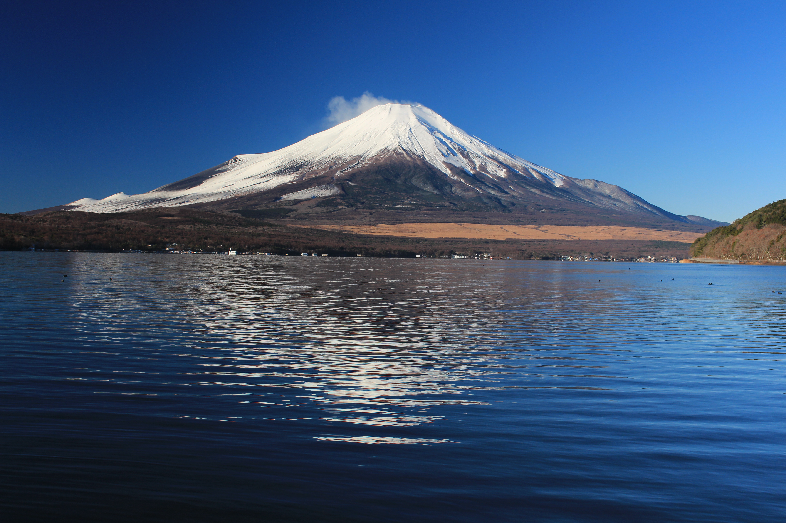

# Céu Alpino

Tema Omarchy inspirado nas montanhas do Japão e na serenidade das paisagens
nórdicas: azul-celeste, neve, água glacial e fundos em azul profundo.



## Instalação

Em uma instalação do [Omarchy](https://omarchy.org/) com suporte a `colors.toml`:

```bash
omarchy theme install https://github.com/johan-akn/omarchy-ceu-alpino-theme.git
```

O comando instala e ativa o tema. Para ativá-lo novamente:

```bash
omarchy theme set ceu-alpino
```

## Paleta

| Uso | Cor |
| --- | --- |
| Fundo | `#142536` |
| Texto | `#e4eef5` |
| Azul-celeste | `#7cc5f4` |
| Ciano glacial | `#8ed8df` |
| Verde | `#a3c9ae` |
| Neve | `#f5f9fc` |

As bordas ativas usam um gradiente de azul-celeste a ciano. Os arquivos dos
aplicativos são gerados pelo Omarchy a partir de `colors.toml`, e os ícones
usam Yaru-blue.

## Licenças

A configuração do tema está disponível sob a [licença MIT](LICENSE).
A fotografia tem sua própria licença e atribuição abaixo.

## Fotografia

Mount Fuji from Lake Yamanaka — Alpsdake, 6 de dezembro de 2014.
Original sem alterações, 5184 × 3456.

Fonte: [Wikimedia Commons](https://commons.wikimedia.org/wiki/File:Mount_Fuji_from_Lake_Yamanaka.JPG).
Licença: [CC BY-SA 4.0](https://creativecommons.org/licenses/by-sa/4.0/).
